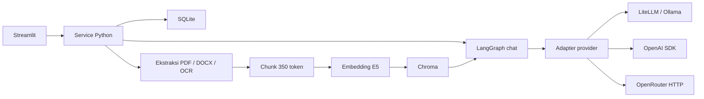

# Tanya AI

Tanya AI adalah aplikasi web untuk bertanya kepada dokumen PDF dan DOCX. Pengguna bisa membuat beberapa agent, misalnya HR dan Legal, lalu memberi masing-masing agent dokumen dan model yang berbeda. Jawaban menyertakan nama file dan halaman atau bagian sumbernya.

Knowledge berasal dari dokumen yang diunggah. Model tidak dilatih ulang saat menerima dokumen baru. Dua agent boleh memakai model yang sama karena pemisahan sumber dilakukan oleh aplikasi.

## Menjalankan aplikasi

Prasyarat: [uv](https://docs.astral.sh/uv/), [Ollama](https://ollama.com/) yang berjalan, serta RAM dan disk yang cukup untuk model 8B. Qwen3:8b perlu unduhan sekitar 5,2 GB. Jalankan perintah dari root repository.

1. Pasang Python dan dependensi sesuai lockfile.
   ```sh
   uv sync --frozen --extra dev --python 3.12
   ```
2. Buat konfigurasi lokal. Key cloud boleh kosong jika memakai Ollama.
   ```sh
   cp .env.example .env
   ```
3. Unduh model chat dan embedding.
   ```sh
   ollama pull qwen3:8b
   uv run python -m src.cli download-embedding
   ```
4. Siapkan OCR jika akan mengunggah scan. Pada macOS:
   ```sh
   brew install poppler tesseract
   uv run python -m scripts.setup_ocr
   ```
   Debian/Ubuntu: `sudo apt-get install poppler-utils tesseract-ocr tesseract-ocr-ind tesseract-ocr-eng`. Untuk PDF dengan teks, langkah OCR bisa dilewati dengan `OCR_ENABLED=false`.
5. Jalankan aplikasi dan buka [localhost:8501](http://localhost:8501).
   ```sh
   uv run streamlit run app.py --server.address 127.0.0.1
   ```

Internet diperlukan untuk unduhan awal. Setelah model tersedia, chat melalui Ollama, embedding, dan OCR dapat berjalan lokal. Restart server setelah mengubah source karena file watcher dimatikan.

### Menggunakan Docker

Siapkan Docker, `.env`, dan Ollama beserta model chat di host, lalu jalankan:

```sh
docker compose up --build -d
docker compose exec app /app/.venv/bin/python -m src.cli download-embedding
```

Compose menghubungi Ollama di `host.docker.internal:11434`. Gunakan `DOCKER_OLLAMA_BASE_URL` jika alamatnya berbeda. Image sudah memuat Poppler dan Tesseract Bahasa Indonesia/Inggris. Volume `app_data` menyimpan database, dokumen, dan cache model; `docker compose down` mempertahankannya, sedangkan `down -v` menghapusnya.

## Cara menggunakan

- **Kelola agent:** buat agent dengan nama, deskripsi, instruksi tambahan, provider, dan model. Aturan dasar untuk memakai sumber aktif dan mengakui kekurangan informasi selalu berlaku.
- **Dokumen:** pilih agent tujuan, unggah file, lalu tekan **Proses dokumen**. Setiap file memiliki status `processing`, `ready`, atau `failed` beserta penjelasannya.
- **Tinjau ekstraksi:** bandingkan PDF asli dengan teks di editor. Untuk DOCX, panel kiri menampilkan teks ekstraksi awal; unduh file asli untuk melihat layout Word.
- **Rapikan baris:** menggabungkan pemenggalan kalimat dan spasi berlebih. Parser sudah melakukan perapian saat upload, jadi hasilnya bisa tidak berubah. Tombol ini tidak membetulkan isi OCR atau susunan tabel. Perubahan hanya masuk knowledge setelah **Simpan koreksi dan indeks ulang**.
- **Percakapan:** pilih agent, ajukan pertanyaan, dan periksa sitasinya. Riwayat tersimpan; membuat percakapan baru tidak menghapus percakapan lama.

Contoh menggunakan perusahaan **simulasi PT XYZ**, dengan template peraturan perusahaan dan regulasi umum berbahasa Indonesia. File dan tautan sumber ada di [panduan dataset](docs/DEMO_DATASET.md). Scan Jamkrida disediakan sebagai contoh OCR terpisah. PDF dan data pengguna tidak disertakan dalam repository.

## Cara kerja



**Saat dokumen masuk**, pypdf atau python-docx mengambil teksnya. Halaman scan memakai Poppler dan Tesseract `ind+eng`. Teks dibagi dengan sliding window sepanjang 350 token dan overlap 50 token, tanpa melewati batas halaman/bagian. Overlap membantu menjaga konteks ketika kalimat terpotong.

**Embedding** memakai `intfloat/multilingual-e5-small` dari Hugging Face melalui Sentence Transformers. Model ini dipilih karena mendukung beberapa bahasa dan bisa berjalan di CPU tanpa biaya API embedding. Hasilnya 384 angka per chunk, dinormalisasi, dengan prefix `passage:` untuk dokumen dan `query:` untuk pertanyaan. Model/dimensi embedding yang berbeda memerlukan collection baru dan reindex.

**Saat pertanyaan masuk**, aplikasi mencari vektor dari agent yang dipilih dan hanya menerima dokumen `ready` pada revisi aktif. Kandidat dicari berdasarkan cosine similarity, disaring dengan threshold default 0,82, kemudian diurutkan ulang memakai TF-IDF character n-gram 3–5. Ini reranking kandidat dense, bukan dua pencarian global terpisah. Defaultnya empat sumber dari maksimal 20 kandidat. Sumber dapat dilengkapi dengan halaman/bagian yang sama, dibatasi 8.000 karakter per bagian dan 16.000 total.

**Jawaban default bersifat extractive.** Model memilih maksimal lima ID bukti; aplikasi menyusun kutipan literal dan sitasi dari ID tersebut. Mode ini dipilih untuk mengurangi penambahan fakta bebas, dengan konsekuensi jawaban kadang panjang atau kurang lengkap. Mode `abstractive` tersedia untuk parafrase dan memakai verifier LLM lokal jika diaktifkan. Baik validasi sitasi maupun verifier tidak menjamin relevansi dan kebenaran seluruh jawaban.

**Pertanyaan lanjutan** melewati rewriter dengan maksimal tiga pasangan pesan sebagai konteks topik, lalu retrieval dilakukan ulang. Riwayat bukan sumber fakta baru. LangGraph mengatur lima tahap: contextualize, retrieve, generate, validate citations, dan verify claims.

## Penyimpanan dan pilihan desain

| Pilihan | Alasan dan konsekuensi |
|---|---|
| Streamlit dengan service Python | Satu proses lebih mudah dijalankan untuk take-home ini. Logic agent, dokumen, dan chat dipisahkan dari UI agar dapat dipakai ulang jika nanti ditambah API. |
| SQLite melalui `sqlite3` | Menyimpan agent, metadata, file asli, ekstraksi, revisi, dan percakapan tanpa server database tambahan. Koneksi memakai foreign key dan WAL. Tidak memakai SQLAlchemy. |
| Chroma persisten | Menyimpan vektor beserta identitas agent/dokumen. SQLite dan Chroma tidak berbagi transaksi, sehingga penghapusan perlu penonaktifan sumber dan cleanup yang dapat dicoba ulang. |
| Antrean satu worker | Upload tidak menahan interaksi UI dan indexing tidak berebut resource. Pekerjaan belum dapat dilanjutkan setelah proses mati; dokumen yang tertinggal `processing` ditandai gagal saat startup. |

Koreksi teks menaikkan revisi dan mengganti indeks. Dokumen tidak dipakai saat reindex; pekerjaan lama tidak boleh menimpa revisi baru. Menghapus dokumen membuat sumbernya tidak dapat dipakai dalam jawaban baru. Sitasi pada arsip chat lama tetap terlihat dengan peringatan. Menghapus agent juga membersihkan dokumen, vektor, dan percakapannya.

## Provider dan konfigurasi

Semua adapter mengikuti `ChatProvider.complete(ChatRequest) -> ChatResponse`. OpenAI dan OpenRouter dipanggil langsung; LiteLLM diperlakukan sebagai provider tersendiri.

| Provider | Jalur | Model default |
|---|---|---|
| LiteLLM | SDK LiteLLM ke server Ollama lokal | `ollama_chat/qwen3:8b` |
| OpenRouter | HTTP ke OpenRouter | `dots-studio/dots-3-note-preview:free` |
| OpenAI | SDK OpenAI langsung | `gpt-4o-mini` |

Provider/model dapat diganti per agent dari UI. Menambah provider keempat memerlukan adapter, factory registry, pilihan UI/config, serta migrasi constraint provider SQLite; logic chat dan retrieval tetap memakai interface yang sama.

Konfigurasi dibaca dari `.env` atau environment process; environment process didahulukan. Key berada pada `OPENAI_API_KEY`/`OPENROUTER_API_KEY`, bukan source. Mengubah model default tidak mengubah agent yang sudah disimpan. Tekan **Muat ulang konfigurasi** atau restart setelah mengubah `.env`.

| Pengaturan | Default |
|---|---|
| `DATA_DIR`, `OLLAMA_BASE_URL` | `./data`, `http://127.0.0.1:11434` |
| `ANSWER_MODE` | `extractive` |
| `SIMILARITY_THRESHOLD`, `RETRIEVAL_TOP_K` | `0.82`, `4` |
| `LOCAL_FALLBACK_MODEL` | `ollama_chat/qwen3:8b` |
| `MAX_UPLOAD_MB`, `OCR_MAX_PAGES` | `500`, `200` |
| `PROVIDER_TIMEOUT_SECONDS` | `180` per panggilan |

Pilihan lain ada di `.env.example`. Batas parser: PDF 300 halaman, teks satu juta karakter, ekspansi DOCX 50 MB/5.000 entry, serta OCR 45 detik per subprocess dan 600 detik total. Batas ini adalah batas penerimaan, bukan klaim kapasitas yang sudah dibenchmark.

Jika OpenRouter gagal, aplikasi mencoba model Ollama lokal sekali per node dan menyimpan pemberitahuan fallback bersama jawaban. Pesannya membedakan timeout, koneksi, limit, dan kategori lain bila ada bukti dari respons provider. Agent LiteLLM langsung dan OpenAI tidak memiliki fallback tambahan. Mengganti model di server Ollama yang sama juga tidak mengatasi server yang mati.

Mode `OPENROUTER_FREE_ONLY=true` membatasi ke ID `:free` atau `openrouter/free`. Ketersediaan dan kuota gratis tetap dapat berubah. Sisa permintaan gratis berbeda dari sisa kredit; lihat [penjelasan batas OpenRouter](https://openrouter.ai/docs/api_reference/limits). Timeout sendiri belum membuktikan kuota habis.

## Evaluasi kualitas jawaban

Evaluasi menggunakan 20 pertanyaan Bahasa Indonesia pada dokumen demo: 10 HR dan 10 Legal, termasuk pertanyaan lanjutan, informasi yang tidak tersedia, dan isolasi knowledge. Qwen3 menghasilkan jawaban; Llama3.1:8b lokal menjadi judge untuk **answer relevance, groundedness, dan context relevance**.

Pertanyaan, rubrik, skor per kasus, contoh kegagalan, dan cara mengulangnya ada di [laporan evaluasi](docs/EVALUATION.md). Skor judge adalah penilaian model pada sampel ini, bukan persentase akurasi atau jaminan jawaban benar. Groundedness tinggi tetap dapat disertai jawaban yang kurang menjawab pertanyaan.

Untuk memeriksa instalasi dan menjalankan unit test ingestion/provider serta perilaku aplikasi:

```sh
uv run python -m src.cli doctor
uv run pytest -q
```

Tes provider memakai mock. OpenAI belum dicoba live karena key tidak tersedia; OpenRouter pernah berhasil sebelumnya, tetapi diagnostik terakhir mengalami timeout. Kemampuan endpoint cloud saat demo perlu diperiksa kembali.

## Keterbatasan dan langkah berikutnya

- Aplikasi diasumsikan untuk satu pengguna lokal. Belum ada login, hak akses, atau dukungan beberapa instance.
- `ready` berarti dokumen terindeks, bukan hasil OCR sudah benar. Tabel, kolom, angka, header/footer, dan text box bisa bermasalah; DOCX tidak diberi nomor halaman buatan.
- Threshold perlu dikalibrasi untuk dokumen lain. Rewriter, pemilihan kutipan, dan verifier masih bisa salah. Mode Thinking tidak menjamin jawaban lebih baik.
- Aplikasi mengikuti isi dan versi file yang diunggah; tidak memeriksa keberlakuan hukum atau kebenaran sumber.
- OCR dan embedding berjalan lokal. Jika memilih provider cloud, potongan dokumen dan konteks percakapan dikirim ke provider tersebut.
- Belum ada streaming, pencatatan biaya per agent, atau deployment cloud. Model lokal tetap dibatasi RAM, waktu proses, dan ketersediaan server.

Jika ada waktu tambahan, prioritas saya adalah memperluas evaluasi dengan dokumen baru dan penilaian manusia, memperbaiki retrieval pada kasus gagal, lalu menambah autentikasi dan job queue yang tahan restart.

## Bantuan pengembangan

Codex dan Gemini membantu perencanaan, penulisan kode, debugging, serta dokumentasi. Bagian ini dicantumkan sesuai permintaan brief; hasil dan keterbatasan evaluasi dijelaskan terpisah agar dapat diperiksa.
