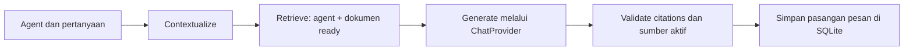

# Ruang Dokumen

Aplikasi web multi-agent document chatbot untuk take-home AI Engineer. Setiap agent dirancang mempunyai instruksi, provider/model, dan sumber dokumen sendiri.

**Status: alur PDF RAG berjalan.** Buat/pilih agent → upload beberapa PDF → ekstraksi per halaman → chunking/embedding → retrieval terisolasi → jawaban bersitasi melalui provider nyata. UI menyediakan edit/hapus agent, status dokumen, hapus dokumen, percakapan persisten, percakapan baru, dan potongan sumber. DOCX dan OCR belum tersedia pada milestone ini.

## Menjalankan secara lokal

Prasyarat: [uv](https://docs.astral.sh/uv/) dan [Ollama](https://ollama.com/) terpasang; daemon Ollama berjalan. Jalankan dari root repository:

1. Pasang dependensi terkunci dan Python 3.12:
   ```sh
   uv sync --frozen --extra dev --python 3.12
   ```
2. Salin konfigurasi contoh:
   ```sh
   cp .env.example .env
   ```
   Sesuaikan bila perlu. Key cloud boleh kosong untuk jalur lokal. Jangan commit `.env`.
3. Siapkan model chat lokal (unduhan hanya diperlukan sekali):
   ```sh
   ollama pull qwen3:8b
   ```
4. Unduh dan verifikasi model embedding:
   ```sh
   uv run python -m src.cli download-embedding
   ```
5. Jalankan aplikasi:
   ```sh
   uv run streamlit run app.py --server.address 127.0.0.1 --browser.gatherUsageStats false
   ```
   Buka [localhost:8501](http://localhost:8501). Penyimpanan dibuat saat aplikasi dibuka.

Model Qwen3 8B sekitar 5,2 GB; embedding memerlukan unduhan tambahan. Qwen3 dipilih setelah smoke test dokumen Indonesia; thinking dinonaktifkan oleh adapter lokal. UI pengelolaan agent dapat berjalan tanpa model, sedangkan indexing dan chat memerlukan model yang sesuai. Agent adalah konfigurasi asisten yang dibuat di UI, bukan paket yang diunduh.

## Pemeriksaan dan pengujian

```sh
uv run python -m src.cli init
uv run python -m src.cli doctor
uv run pytest -q
uv run ruff check .
uv run ruff format --check .
```

`doctor` memeriksa Python/dependensi, integritas SQLite, foreign key, Chroma, cache embedding, koneksi Ollama, model yang tersedia, serta status Docker. Exit code 1 berarti prasyarat pengembangan lokal belum lengkap; key cloud dan Docker opsional untuk jalur native. Nilai key tidak dicetak. Deteksi cache membaca file model; `download-embedding` melakukan inference embedding sebenarnya. Probe Ollama pada doctor membaca daftar model, bukan menguji generasi.

30 test otomatis lulus. Cakupannya mencakup CRUD/persistensi, foreign key lintas agent, cascade/retry cleanup, PDF rusak/kosong/tanpa teks, ingestion gagal, banyak dokumen, isolasi retrieval dua arah, delete pada sesi lama, output JSON/sitasi tidak valid, error provider, serta interaksi chat/sumber/delete di Streamlit AppTest. Adapter OpenAI dan OpenRouter diuji memakai SDK/HTTP mock; pengujian tersebut bukan panggilan cloud nyata.

Untuk smoke test live lokal dengan kebijakan publik PT Vale:

```sh
uv run python -m scripts.prepare_demo
uv run python -m scripts.smoke_local
```

Script pertama mengunduh empat kebijakan resmi, memeriksa checksum revisi, dan mengambil halaman badan Bahasa Indonesia tanpa menerjemahkan/mengubah isi. Header, istilah, dan daftar referensi resmi dapat tetap berbahasa Inggris. PDF tersimpan di `data/demo/{hr,legal}/` dan manifest pemetaan halaman di `data/demo/manifest.json`; binary tidak disertakan dalam Git. Bila sumber berubah, script berhenti agar revisi dan halaman diperiksa ulang. Sumber: [kebijakan publik PT Vale Indonesia](https://vale.com/in/indonesia/kebijakan-kami).

Hasil lokal terakhir: tujuh skenario smoke test lulus melalui LiteLLM/Ollama Qwen3. Satu uji Streamlit AppTest tambahan juga menjalankan chat input → retrieval nyata → provider nyata → expander sitasi halaman 3. Pemeriksaan Chrome native mengalami timeout; upload melalui file picker browser belum diperiksa manual.

Smoke test memakai data terpisah di `data/smoke/`, bukan agent/dokumen UI pengguna. Tujuh skenario: jawaban HR bersitasi, frekuensi sebagai follow-up, penolakan jumlah cuti yang tidak tersedia, penolakan fakta Legal pada HR, jawaban Legal bersitasi, penolakan setelah sumber dihapus pada sesi lama, dan jawaban dari dokumen Legal yang tersisa. Pemeriksaan sitasi dan beberapa anchor fakta bukan evaluasi entailment otomatis menyeluruh. Laporan lokal tidak ikut Git.

## Docker

Setelah `.env` tersedia dan Docker Desktop berjalan:

```sh
docker compose up --build -d
```

Compose memakai port lokal 8501 dan volume `app_data`. Hentikan server native dahulu jika port terpakai. Ollama berjalan di host; Compose memakai `host.docker.internal:11434`, dapat diganti dengan `DOCKER_OLLAMA_BASE_URL`. Cache model native tidak otomatis masuk ke volume Docker. Siapkan embedding di container dengan:

```sh
docker compose exec app /app/.venv/bin/python -m src.cli download-embedding
```

`docker compose down` mempertahankan volume. Hindari opsi `-v` bila data masih diperlukan. PyTorch CPU untuk Linux dikonfigurasi melalui [index resmi sesuai panduan uv](https://docs.astral.sh/uv/guides/integration/pytorch/), untuk menghindari unduhan CUDA pada demo ini. Validasi 22 Oktober 2026: build berhasil; container non-root berhasil menjalankan `src.cli init` (SQLite/Chroma ready), HTTP health check merespons `ok`, dan probe Ollama dari container menemukan model pilihan. Container uji dihentikan setelah pemeriksaan. Inference embedding CPU di image final juga berhasil (384 dimensi), memakai cache host yang dipasang read-only dengan mode offline. Cache model tetap harus disiapkan pada volume container untuk penggunaan biasa.

## Struktur dan keputusan teknis

```text
app.py                     UI Streamlit
src/config.py              Konfigurasi tervalidasi dari environment/.env
src/bootstrap.py           Perakitan service dan penyimpanan
src/database/connection.py  SQLite, schema, koneksi per operasi
src/services/agents.py     Operasi agent dan koordinasi penghapusan
src/knowledge/             Chroma dan embedding lokal
src/cli.py                 Init, doctor, unduhan/verifikasi embedding
src/providers/             Interface sendiri dan tiga adapter independen
src/services/chat.py       Alur LangGraph dan persistensi percakapan
src/services/documents.py  Lifecycle upload/index/delete dokumen
scripts/                   Persiapan demo dan smoke test live lokal
tests/                     Pengujian unit/integrasi dan interaksi UI
```

Streamlit mempercepat implementasi aplikasi web dalam tenggat singkat. Backend berupa service Python modular dalam proses yang sama; REST API terpisah belum dibuat. SQLite menghindari server database tambahan. Chroma menyimpan indeks dengan metadata agent; retrieval memfilter `agent_id` dan ID dokumen berstatus `ready`, lalu memeriksa ulang sumber aktif sebelum menyimpan jawaban. Kandidat dense diambil hingga 5× top-k (maksimal 50), disaring threshold, lalu diurutkan ulang dengan TF-IDF character n-gram 3–5 sebelum memilih empat sumber. Reranking ini memperbaiki pemilihan klausul kontrak yang semula tertutup paragraf umum; belum merupakan BM25 index terpisah atau neural reranker.

Setiap koneksi SQLite mengaktifkan foreign key dan memakai transaksi sendiri. Penghapusan agent menonaktifkannya dahulu, membersihkan vektor, kemudian menghapus data relasional melalui cascade. Karena SQLite dan Chroma tidak berbagi transaksi, kegagalan pembersihan meninggalkan agent berstatus `deleting`, tersembunyi dari pilihan aktif, dan dapat dicoba ulang melalui UI.

Embedding memakai `intfloat/multilingual-e5-small`, 384 dimensi, normalisasi, dan prefix `query:`/`passage:`. Model multilingual dipilih untuk dokumen Indonesia dan berjalan lokal tanpa biaya API embedding. Embedding terpisah dari model chat. Mengubah model/dimensi membutuhkan collection baru dan reindex; aplikasi menolak konfigurasi yang tidak sesuai indeks tersimpan. Threshold cosine awal 0,83 disesuaikan memakai contoh positif/negatif PT Vale: sumber relevan siklus karyawan sekitar 0,870 dan Red Flags 0,847, sedangkan kandidat Human Rights setelah Anti-Corruption dihapus sekitar 0,803–0,810. Nilai ini bergantung pada embedding/dataset dan perlu diuji ulang untuk dokumen lain; skor bukan probabilitas kebenaran.

## Alur RAG, sitasi, dan provider



LangGraph mengatur empat node tersebut; retrieval dan adapter ditulis sebagai modul aplikasi. Agent merupakan konfigurasi instruksi/provider/model dengan namespace knowledge, bukan sekumpulan model yang harus berkomunikasi satu sama lain. Follow-up pendek memakai pertanyaan user sebelumnya untuk memperjelas topik. Jawaban assistant lama tidak dimasukkan sebagai bukti.

PDF dibaca dengan pypdf, mempertahankan nomor halaman **PDF yang diunggah**. Chunk dibatasi 350 token tokenizer E5 dengan overlap 50, tidak melintasi halaman. Embedding selesai dan indeks tersimpan sebelum status menjadi `ready`. Status `processing` yang tertinggal setelah restart berubah menjadi `failed`. Pemrosesan sinkron menampilkan progres per dokumen dan menahan interaksi sesi selama pekerjaan berjalan; belum ada worker background. Batas awal: 20 MB/file, 300 halaman, satu juta karakter teks. PDF terlindungi, rusak, kosong, atau scan tanpa teks mendapatkan error yang dapat dibaca.

Node generate meminta JSON `status/answer/source_ids`. Keputusan `unknown` menghasilkan penolakan standar. ID sumber harus berasal dari hasil retrieval aktif; output tidak valid gagal menjadi jawaban bersumber. Aplikasi memetakan ID tersebut ke nama file, halaman, dan potongan teks. Validasi ID tidak membuktikan semua klaim didukung; user tetap dapat memeriksa potongan sumber. Kualitas model dan prompt tetap memengaruhi ketepatan/kelengkapan jawaban.

Hapus dokumen terlebih dahulu mengeluarkannya dari daftar `ready`, lalu membersihkan vektor dan metadata. Jika cleanup gagal, dokumen tetap tidak dapat diretrieve dan tombol hapus dapat dicoba ulang. Pesan historis tetap terlihat dengan peringatan jika sumbernya tidak aktif; pesan tersebut tidak dipakai sebagai knowledge untuk jawaban baru. Teks sumber yang tersimpan pada riwayat merupakan bukti jawaban lama, sehingga penghapusan dokumen bukan penghapusan seluruh arsip percakapan.

Kontrak milik aplikasi: `ChatProvider.complete(ChatRequest) -> ChatResponse`. Registry memilih implementasi berdasarkan konfigurasi agent:

| Provider | Implementasi | Validasi |
|---|---|---|
| LiteLLM | Memanggil `litellm.completion` sendiri; jalur default Ollama lokal | Unit test dan RAG live Qwen3 |
| OpenAI | SDK OpenAI langsung | SDK mock; belum live karena key belum diisi |
| OpenRouter | HTTP langsung ke endpoint OpenRouter | HTTP mock termasuk 401/429; belum live karena key belum diisi |

Model cloud harus mendukung chat dan JSON object output. API key dibaca dari environment/`.env`; log aplikasi hanya mencatat ID, status, dan tipe error. LiteLLM memakai metadata biaya bawaan paket untuk menghindari refresh peta model lewat jaringan; aplikasi belum melaporkan biaya aktual. Timeout/rate limit/key salah diterjemahkan ke pesan UI yang aman. Tidak ada fallback otomatis atau klaim cloud gratis.

Provider keempat memerlukan adapter baru, pendaftaran factory, serta penambahan pilihan/validasi konfigurasi UI. Logic chat dan retrieval tetap menggunakan kontrak yang sama. Tidak ada ketergantungan adapter OpenAI/OpenRouter pada LiteLLM.

## Batasan dan pekerjaan berikutnya

- DOCX merupakan requirement wajib yang belum dikerjakan pada milestone PDF ini; OCR bonus belum tersedia.
- OpenAI/OpenRouter belum diuji live. Belum ada video submission atau evaluasi 10–20 pertanyaan per agent.
- Contextualization berupa heuristik pertanyaan sebelumnya; follow-up yang bergantung pada nomor poin jawaban lama belum ditangani penuh.
- Kalibrasi threshold dan smoke test kecil bukan ukuran akurasi umum. Model lain dapat lebih sering menolak atau menjawab kurang lengkap.
- Pemrosesan belum diisolasi dalam worker; aplikasi ditujukan untuk penggunaan lokal satu pengguna, tanpa autentikasi/multi-user.
- RAG lengkap di dalam Docker belum diuji; build, init penyimpanan, health, koneksi host, dan inference embedding dengan cache read-only telah diuji. Uji setup clean-clone penuh masih diperlukan.

## Bantuan AI

Codex/AI membantu perencanaan, implementasi, pengujian, dan dokumentasi. Masukan AI ditinjau terhadap brief; status implementasi dan validasi dijelaskan sesuai bukti. Catatan koordinasi pribadi, rahasia, cache model, serta data runtime tidak disertakan dalam repository.

