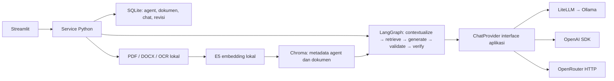

# Ruang Dokumen

Aplikasi web chatbot dokumen dengan agent HR dan Legal yang memiliki konfigurasi dan knowledge terpisah. Knowledge berasal dari PDF/DOCX yang diunggah; aplikasi tidak mengisi jawaban dari pengetahuan umum model.

Buat agent → pilih provider/model → unggah dokumen → tinjau ekstraksi → tanya dan periksa sitasi. Mendukung CRUD agent, beberapa dokumen per agent, OCR lokal, editor ekstraksi dengan PDF berdampingan, penghapusan sumber, percakapan tersimpan, dan Fast/Thinking.

## Menjalankan dalam lima langkah

Prasyarat: Python 3.12 melalui [uv](https://docs.astral.sh/uv/), [Ollama](https://ollama.com/) yang berjalan, dan ruang disk untuk model. Qwen3:8b memerlukan unduhan sekitar 5,2 GB; sediakan RAM untuk model 8B dan aplikasi. Jalankan dari root repository.

1. Pasang dependensi terkunci:
   ```sh
   uv sync --frozen --extra dev --python 3.12
   ```
2. Siapkan konfigurasi lokal:
   ```sh
   cp .env.example .env
   ```
   Key cloud boleh kosong. Default memakai LiteLLM → Ollama → Qwen3:8b.
3. Unduh model chat dan embedding:
   ```sh
   ollama pull qwen3:8b
   uv run python -m src.cli download-embedding
   ```
4. Siapkan OCR jika akan mengunggah scan. Di macOS:
   ```sh
   brew install poppler tesseract
   uv run python -m scripts.setup_ocr
   ```
   Di Debian/Ubuntu: `sudo apt-get install poppler-utils tesseract-ocr tesseract-ocr-ind tesseract-ocr-eng`. Untuk dokumen dengan text layer saja, OCR boleh dinonaktifkan melalui `OCR_ENABLED=false`.
5. Jalankan:
   ```sh
   uv run streamlit run app.py --server.address 127.0.0.1
   ```
   Buka [localhost:8501](http://localhost:8501). File watcher dimatikan untuk menghindari introspeksi lazy imports Transformers; restart server setelah mengubah source.

Unduhan model pertama memerlukan internet. Sesudah model tersedia, jalur lokal tidak memakai key atau kuota API cloud. Kecepatan tetap bergantung pada perangkat dan server Ollama.

## Docker

Prasyarat: Docker Desktop, `.env` dari contoh, serta Ollama/model chat di host.

```sh
docker compose up --build -d
docker compose exec app /app/.venv/bin/python -m src.cli download-embedding
```

Buka localhost:8501. Hentikan server native jika port terpakai. Image menyertakan Poppler, Tesseract, serta bahasa Indonesia/Inggris. Compose memakai `host.docker.internal:11434` untuk Ollama, dapat diganti dengan `DOCKER_OLLAMA_BASE_URL`. PyTorch menggunakan wheel CPU pada Linux.

SQLite, vektor, file asli dan cache embedding berada pada volume `app_data`; cache native tidak otomatis masuk ke Docker. `docker compose down` mempertahankan volume, sedangkan opsi `-v` menghapus data volume.

## Mencoba aplikasi

- Pada **Kelola agent**, buat `HR PT XYZ` dan `Legal PT XYZ`. Instruksi tambahan boleh kosong; system prompt grounding, Bahasa Indonesia, sitasi dan penolakan ketika bukti kurang selalu aktif. Provider dan model berupa dropdown.
- Pada **Dokumen**, pilih agent tujuan secara eksplisit, pilih beberapa PDF/DOCX lalu tekan **Proses dokumen**. Tombol menampilkan proses dengan animasi dan selesai berwarna hijau. Status tiap file: `processing`, `ready`, atau `failed` beserta pesan kesalahan.
- Buka **Tinjau dan koreksi hasil ekstraksi**. PDF asli tampil di kiri dan teks halaman di kanan. Periksa OCR, gunakan **Rapikan pemenggalan baris** bila perlu, lalu **Simpan koreksi dan indeks ulang**. Simpan tiap halaman sebelum berpindah. PDF asli dan snapshot parser awal tidak diubah.
- Pada **Percakapan**, pilih agent, gunakan Fast untuk respons singkat atau Thinking jika model mendukungnya. Pilih kembali percakapan melalui **Riwayat percakapan**; **Percakapan baru** menyimpan percakapan sebelumnya.
- Buka sitasi untuk memeriksa nama file, halaman/bagian, revisi dan teks sumber. Setelah dokumen dihapus atau dikoreksi, sumber lama ditandai tidak aktif/usang dan tidak dipakai sebagai knowledge baru.

Dataset utama adalah **simulasi PT XYZ**, memakai template PP berbahasa Indonesia dan regulasi umum pendamping. PP Jamkrida dipakai terpisah untuk contoh OCR; identitas dan kebijakannya tidak diubah menjadi PT XYZ. Sumber, instruksi persiapan dan contoh pertanyaan ada di [panduan dataset](docs/DEMO_DATASET.md). PDF lokal tidak ikut repository.

## Arsitektur dan alur data



Backend berupa service Python dalam proses Streamlit. Ini mengurangi konfigurasi jaringan untuk tenggat take-home; belum ada REST API terpisah. UI memanggil service, sehingga API dapat ditambahkan sebagai lapisan di atas service yang sama. Agent adalah konfigurasi asisten dengan namespace knowledge, bukan model tersendiri atau model yang saling berdiskusi.

SQLite mengaktifkan foreign key pada setiap koneksi; metadata, chat, file asli dan snapshot teks persisten. Chroma menyimpan vektor persisten. Retrieval memfilter `agent_id`, dokumen `ready`, dan revisi yang aktif, lalu memeriksa kembali sumber sebelum menyimpan jawaban. Penghapusan agent menonaktifkan agent dahulu, membersihkan vektor, lalu melakukan cascade data relasional. Kegagalan cleanup menyisakan status yang dapat dicoba ulang karena SQLite dan Chroma tidak berbagi transaksi.

Embedding `intfloat/multilingual-e5-small` berjalan lokal: 384 dimensi, normalisasi, prefix `query:`/`passage:`. Model multilingual dipilih untuk Bahasa Indonesia dan terpisah dari model chat. Mengubah model/dimensi memerlukan collection baru dan reindex; konfigurasi yang tidak cocok ditolak.

PDF mempertahankan nomor halaman file upload; DOCX memakai heading/paragraf/tabel/baris karena halaman Word tidak stabil. Chunk 350 token tokenizer E5, overlap 50, tidak melintasi halaman. Retrieval mengambil hingga 5× top-k (maksimal 50), menyaring cosine threshold 0,82, kemudian rerank TF-IDF character n-gram 3–5. Halaman/bagian lengkap dari revisi yang sama dipakai untuk melengkapi konteks jika muat: maksimal 8.000 karakter per bagian dan 16.000 karakter total. Ini mengurangi potongan kalimat, tetapi bukan jaminan semua syarat ikut terambil. Threshold adalah parameter dataset, bukan probabilitas kebenaran.

Follow-up memakai maksimal tiga pasangan pesan untuk menulis ulang pertanyaan menjadi mandiri. Hanya jawaban lama dengan sumber yang masih aktif boleh menjadi konteks topik. Fakta tetap berasal dari retrieval baru. Rewriter dapat menambah satu panggilan model; riwayat sangat lama dan rujukan ambigu dapat ditolak.

Default `ANSWER_MODE=extractive`: model memilih maksimal lima ID bukti. Kode menyusun jawaban dari teks bukti literal, mengabaikan teks jawaban bebas model, memeriksa ID dan revisi, lalu menampilkan sitasi. Scope nama file dan pemeriksaan jenis nilai mengurangi jawaban angka yang tidak didukung. Ini memverifikasi asal teks, **bukan jaminan relevansi, kelengkapan atau kebenaran dokumen**.

Mode opsional `ANSWER_MODE=abstractive` memakai parafrase dan `CITATION_VERIFIER_ENABLED=true` untuk verifikasi LLM lokal beserta pengecekan kutipan literal. Evaluasi menemukan false positive/negative pada verifier, sehingga ia tidak dijadikan satu-satunya pengaman. Lihat [laporan grounding](docs/evaluation/GROUNDING_MITIGATION.md).

## Provider, model dan fallback

Kontrak ditulis di aplikasi: `ChatProvider.complete(ChatRequest) -> ChatResponse`. Registry memilih adapter tanpa mengubah retrieval atau logic chat.

| Provider | Implementasi sendiri | Model/jalur awal | Bukti |
|---|---|---|---|
| LiteLLM | Memanggil SDK LiteLLM | Ollama lokal `qwen3:8b` | Unit test dan RAG live lokal |
| OpenRouter | HTTP langsung, independen dari LiteLLM | `dots-studio/dots-3-note-preview:free` | HTTP mock dan smoke live sebelumnya |
| OpenAI | SDK OpenAI langsung | `gpt-4o-mini` | SDK mock; belum live, tidak tersedia key |

LiteLLM adalah SDK penghubung; Ollama adalah server terpisah yang menjalankan model. Agent berbeda boleh memakai model yang sama karena knowledge diisolasi oleh aplikasi. Provider keempat membutuhkan adapter, pendaftaran factory dan pilihan UI/config; chat/retrieval tetap memakai interface yang sama.

Untuk OpenRouter, isi `OPENROUTER_API_KEY=` pada `.env` lokal, restart atau tekan **Muat ulang konfigurasi**, lalu pilih provider/model di agent. Key tidak ditampilkan atau disertakan dalam Git. `OPENROUTER_FREE_ONLY=true` membatasi ke `:free` atau `openrouter/free`; model harus mendukung chat dan JSON output. Ketersediaan model dan kuota gratis dapat berubah, sehingga tidak ada jaminan demo/reviewer selalu mendapat layanan cloud.

Fallback otomatis berlaku untuk error OpenRouter: satu kali mencoba LiteLLM/Ollama dengan `LOCAL_FALLBACK_MODEL`. Default Qwen3 yang sama; dapat diarahkan ke `ollama_chat/llama3.1:8b` setelah model diunduh. Ini tidak mengatasi Ollama/mesin yang mati. Agent LiteLLM langsung dan OpenAI tidak memiliki fallback tambahan. JSON atau sitasi invalid ditolak, tanpa fallback kualitas. Pemberitahuan fallback disimpan bersama jawaban. Timeout/rate limit/key salah ditampilkan sebagai error aman.

## OCR dan lifecycle dokumen

OCR memakai Poppler + Tesseract `ind+eng` secara lokal. Halaman dengan sedikit teks dan image mendapat OCR otomatis; hasil ditandai **OCR** pada locator. Batas: 20 MB/file, 300 halaman PDF, 40 halaman scan, 45 detik per subprocess OCR, 300 detik total OCR dan satu juta karakter teks. Batas halaman scan dapat diatur melalui `OCR_MAX_PAGES`. Tanpa tool/bahasa yang diperlukan, atau jika OCR gagal/kosong, aplikasi menampilkan error jelas dan status `failed`.

Tesseract dipilih agar OCR CPU sederhana dan dapat dijalankan tanpa LLM/key tambahan. MinerU tidak menjadi dependensi pada versi ini. Tabel, kolom, scan buram dan angka dapat salah; **ready berarti terindeks, bukan hasil OCR telah disahkan**. Gunakan preview/editor sebelum mengandalkan jawaban.

Upload berjalan di satu worker background per proses; koneksi SQLite dibuat per operasi. Rerun UI tidak memulai ulang pekerjaan. Setelah restart, dokumen `processing` menjadi `failed` dengan petunjuk unggah ulang. Antrean bukan job queue terdistribusi yang tahan restart. Simpan koreksi melakukan reindex sinkron; selama proses itu dokumen tidak dapat diretrieve.

Koreksi menaikkan revisi; konflik revisi usang ditolak. File asli dan parser snapshot tetap tersimpan. Dokumen lama sebelum fitur penyimpanan asli memerlukan unggah ulang untuk viewer. Menghapus dokumen menghapus file/teks/vector terkait, tetapi riwayat chat lama beserta kutipannya tetap menjadi arsip dan diberi peringatan sumber tidak aktif.

## Validasi

```sh
uv run python -m src.cli init
uv run python -m src.cli doctor
uv run pytest -q
uv run ruff check .
uv run ruff format --check .
```

`doctor` memeriksa SQLite/foreign key, Chroma, cache embedding, Ollama/model, dependensi dan kesiapan OCR tanpa mencetak key. Docker opsional untuk jalur native.

Suite terbaru: **111 tes lulus**, termasuk ingestion PDF/DOCX, OCR error/locator, provider contract/error, CRUD/cascade, isolasi, revisi/editor, sitasi, multi-turn, antrean upload dan Streamlit AppTest. Provider pada suite ini memakai mock; ini bukan ukuran akurasi semua jawaban model live. Hasil pemeriksaan terarah dataset baru, browser dan setup ada di [catatan integrasi](docs/evaluation/INTEGRATION_CHECKS.md).

Skrip `scripts.prepare_demo`, `smoke_local`, `smoke_docx`, dan `compare_local_models` tetap memakai korpus PT Vale **historis** agar evaluasi lama dapat direproduksi; bukan dataset demo utama yang sekarang. Skrip live bersifat opt-in dan tidak dipanggil oleh pytest. Data/log mentah berada di `data/` yang di-ignore.

## Batasan dan trade-off

- Aplikasi satu pengguna lokal; belum ada autentikasi, izin lintas akun, atau deployment publik. Isolasi yang diuji adalah namespace agent.
- OCR/editor tidak membuktikan isi dokumen benar. Aplikasi menjawab versi yang diunggah, bukan menilai keberlakuan hukum atau mencari pembaruan peraturan.
- Pemilihan bukti dapat kurang relevan/lengkap; kutipan dapat panjang dan kurang luwes. Unknown yang terlalu konservatif masih mungkin terjadi pada pertanyaan/dokumen lain.
- Thinking lebih lambat dan tidak menjamin kualitas lebih baik; dukungannya bergantung model. Teks penalaran internal tidak ditampilkan.
- OpenAI belum diuji live. Cloud free dapat rate-limit atau berubah. Model lokal dibatasi RAM/CPU/server dan timeout.
- DOCX belum menangani OCR gambar, header/footer/text box/komentar/tracked changes secara khusus; preview visual Word belum tersedia.
- Streaming, estimasi biaya, background job persisten dan cloud deployment belum diimplementasikan.

## Bantuan AI

Codex/AI membantu perencanaan, implementasi, pengujian, debugging dan dokumentasi. Masukan diperiksa terhadap brief dan bukti pengujian; kegagalan serta batasan dicatat. Catatan koordinasi pribadi, key, cache model, unggahan pengguna dan data runtime tidak disertakan dalam repository.

## Evaluasi Qwen3 dan Llama3.1

Baseline sebelum mitigasi extractive, pada 22 Oktober 2026: 10 pertanyaan HR dan 10 Legal serta 6 skenario DOCX/multi-turn/delete/revisi, dua pengulangan per model. Generator memakai prompt/retrieval/context yang sama dan verifier dinonaktifkan agar tidak menjadi penilai kandidat lain; verifier masing-masing diuji terpisah dengan 6 klaim tetap. Tidak ada panggilan cloud atau perubahan data aplikasi utama.

| Metrik | Qwen3:8b | Llama3.1:8b |
|---|---:|---:|
| Lolos rubrik otomatis | 48/52 | 48/52 |
| Unknown tepat ketika model dipanggil | 4/4 | 2/4 |
| Median latensi tanpa verifier | 3,99 detik | 3,74 detik |
| Verifier menerima klaim salah | 2/6 | 4/6 |

Keduanya salah memilih dokumen pada satu pertanyaan, dan kedua verifier memiliki false positive. Rubrik bukan akurasi entailment; beberapa jawaban lolos kata kunci tetapi coverage sitasinya belum lengkap. Sampel unknown yang mencapai model hanya dua pertanyaan unik, masing-masing diulang dua kali. Qwen tetap default sementara berdasarkan profil penolakan yang lebih konservatif pada sampel ini; tidak diklaim paling robust secara umum. Detail protokol, metrik retrieval, model digest, kegagalan, dan batasan ada di [laporan evaluasi](docs/evaluation/LOCAL_MODEL_COMPARISON.md) dan [ringkasan terstruktur](eval/local_model_results.json). Rancangan mitigasi M14 ada di [laporan grounding](docs/evaluation/GROUNDING_MITIGATION.md); test suite memeriksa struktur/source behavior, bukan live answer quality.
