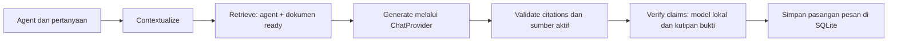

# Ruang Dokumen

Aplikasi web multi-agent document chatbot untuk take-home AI Engineer. Setiap agent dirancang mempunyai instruksi, provider/model, dan sumber dokumen sendiri.

**Status: alur PDF/DOCX RAG berjalan.** Buat/pilih agent → upload beberapa PDF/DOCX → ekstraksi halaman/bagian → chunking/embedding → retrieval terisolasi → jawaban bersitasi melalui provider nyata. UI menyediakan edit/hapus agent, status dokumen, hapus dokumen, percakapan persisten, percakapan baru, dan potongan sumber. DOCX mendukung paragraf dan tabel dengan sitasi bagian/paragraf/baris. OCR belum tersedia.

## Menjalankan secara lokal

Prasyarat: [uv](https://docs.astral.sh/uv/) dan [Ollama](https://ollama.com/) terpasang; daemon Ollama berjalan. Jalankan dari root repository:

1. Pasang dependensi terkunci dan Python 3.12:
   ```sh
   uv sync --frozen --extra dev --python 3.12
   ```
2. Salin konfigurasi contoh:
   ```sh
   cp .env.example .env
   ```
   Sesuaikan bila perlu. Key cloud boleh kosong untuk jalur lokal. Jangan commit `.env`.
3. Siapkan model chat lokal (unduhan hanya diperlukan sekali):
   ```sh
   ollama pull qwen3:8b
   ```
4. Unduh dan verifikasi model embedding:
   ```sh
   uv run python -m src.cli download-embedding
   ```
5. Jalankan aplikasi:
   ```sh
   uv run streamlit run app.py --server.address 127.0.0.1 --browser.gatherUsageStats false
   ```
   Buka [localhost:8501](http://localhost:8501). Penyimpanan dibuat saat aplikasi dibuka.

Model Qwen3 8B sekitar 5,2 GB; embedding memerlukan unduhan tambahan. Qwen3 dipilih setelah smoke test dokumen Indonesia; thinking dinonaktifkan oleh adapter lokal. UI pengelolaan agent dapat berjalan tanpa model, sedangkan indexing dan chat memerlukan model yang sesuai. Agent adalah konfigurasi asisten yang dibuat di UI, bukan paket yang diunduh.

## Pemeriksaan dan pengujian

```sh
uv run python -m src.cli init
uv run python -m src.cli doctor
uv run pytest -q
uv run ruff check .
uv run ruff format --check .
```

`doctor` memeriksa Python/dependensi, integritas SQLite, foreign key, Chroma, cache embedding, koneksi Ollama, model yang tersedia, serta status Docker. Exit code 1 berarti prasyarat pengembangan lokal belum lengkap; key cloud dan Docker opsional untuk jalur native. Nilai key tidak dicetak. Deteksi cache membaca file model; `download-embedding` melakukan inference embedding sebenarnya. Probe Ollama pada doctor membaca daftar model, bukan menguji generasi.

78 test otomatis lulus. Cakupannya mencakup CRUD/persistensi, foreign key lintas agent, cascade/retry cleanup, PDF/DOCX rusak/kosong/tanpa teks, tabel DOCX, ingestion gagal, banyak dokumen, isolasi retrieval dua arah, delete pada sesi lama, output JSON/sitasi tidak valid, error provider, serta interaksi chat/sumber/delete di Streamlit AppTest. Adapter OpenAI dan OpenRouter memiliki SDK/HTTP mock untuk error dan kontrak; hasil live dicatat terpisah.

Untuk smoke test live lokal dengan kebijakan publik PT Vale:

```sh
uv run python -m scripts.prepare_demo
uv run python -m scripts.smoke_local
uv run python -m scripts.smoke_docx
```

Script pertama mengunduh empat kebijakan resmi, memeriksa checksum revisi, dan mengambil halaman badan Bahasa Indonesia tanpa menerjemahkan/mengubah isi. Header, istilah, dan daftar referensi resmi dapat tetap berbahasa Inggris. PDF tersimpan di `data/demo/{hr,legal}/` dan manifest pemetaan halaman di `data/demo/manifest.json`; binary tidak disertakan dalam Git. Bila sumber berubah, script berhenti agar revisi dan halaman diperiksa ulang. Sumber: [kebijakan publik PT Vale Indonesia](https://vale.com/in/indonesia/kebijakan-kami).

Hasil lokal terakhir: tujuh skenario smoke test lulus melalui LiteLLM/Ollama Qwen3. Satu uji Streamlit AppTest tambahan juga menjalankan chat input → retrieval nyata → provider nyata → expander sitasi halaman 3. Pemeriksaan Chrome native mengalami timeout; upload melalui file picker browser belum diperiksa manual.

Smoke test memakai data terpisah di `data/smoke/`, bukan agent/dokumen UI pengguna. Tujuh skenario: jawaban HR bersitasi, frekuensi sebagai follow-up, penolakan jumlah cuti yang tidak tersedia, penolakan fakta Legal pada HR, jawaban Legal bersitasi, penolakan setelah sumber dihapus pada sesi lama, dan jawaban dari dokumen Legal yang tersisa. Pemeriksaan sitasi dan beberapa anchor fakta bukan evaluasi entailment otomatis menyeluruh. Laporan lokal tidak ikut Git.

## Docker

Setelah `.env` tersedia dan Docker Desktop berjalan:

```sh
docker compose up --build -d
```

Compose memakai port lokal 8501 dan volume `app_data`. Hentikan server native dahulu jika port terpakai. Ollama berjalan di host; Compose memakai `host.docker.internal:11434`, dapat diganti dengan `DOCKER_OLLAMA_BASE_URL`. Cache model native tidak otomatis masuk ke volume Docker. Siapkan embedding di container dengan:

```sh
docker compose exec app /app/.venv/bin/python -m src.cli download-embedding
```

`docker compose down` mempertahankan volume. Hindari opsi `-v` bila data masih diperlukan. PyTorch CPU untuk Linux dikonfigurasi melalui [index resmi sesuai panduan uv](https://docs.astral.sh/uv/guides/integration/pytorch/), untuk menghindari unduhan CUDA pada demo ini. Validasi 22 Oktober 2026: build berhasil; container non-root berhasil menjalankan `src.cli init` (SQLite/Chroma ready), HTTP health check merespons `ok`, dan probe Ollama dari container menemukan model pilihan. Container uji dihentikan setelah pemeriksaan. Inference embedding CPU di image final juga berhasil (384 dimensi), memakai cache host yang dipasang read-only dengan mode offline. Cache model tetap harus disiapkan pada volume container untuk penggunaan biasa.

## Struktur dan keputusan teknis

```text
app.py                     UI Streamlit
src/config.py              Konfigurasi tervalidasi dari environment/.env
src/bootstrap.py           Perakitan service dan penyimpanan
src/database/connection.py  SQLite, schema, koneksi per operasi
src/services/agents.py     Operasi agent dan koordinasi penghapusan
src/knowledge/             Chroma dan embedding lokal
src/cli.py                 Init, doctor, unduhan/verifikasi embedding
src/providers/             Interface sendiri dan tiga adapter independen
src/services/chat.py       Alur LangGraph dan persistensi percakapan
src/services/documents.py  Lifecycle upload/index/delete dokumen
scripts/                   Persiapan demo dan smoke test live lokal
tests/                     Pengujian unit/integrasi dan interaksi UI
```

Streamlit mempercepat implementasi aplikasi web dalam tenggat singkat. Backend berupa service Python modular dalam proses yang sama; REST API terpisah belum dibuat. SQLite menghindari server database tambahan. Chroma menyimpan indeks dengan metadata agent; retrieval memfilter `agent_id` dan ID dokumen berstatus `ready`, lalu memeriksa ulang sumber aktif sebelum menyimpan jawaban. Kandidat dense diambil hingga 5× top-k (maksimal 50), disaring threshold, lalu diurutkan ulang dengan TF-IDF character n-gram 3–5 sebelum memilih empat sumber. Reranking ini memperbaiki pemilihan klausul kontrak yang semula tertutup paragraf umum; belum merupakan BM25 index terpisah atau neural reranker.

Setiap koneksi SQLite mengaktifkan foreign key dan memakai transaksi sendiri. Penghapusan agent menonaktifkannya dahulu, membersihkan vektor, kemudian menghapus data relasional melalui cascade. Karena SQLite dan Chroma tidak berbagi transaksi, kegagalan pembersihan meninggalkan agent berstatus `deleting`, tersembunyi dari pilihan aktif, dan dapat dicoba ulang melalui UI.

Embedding memakai `intfloat/multilingual-e5-small`, 384 dimensi, normalisasi, dan prefix `query:`/`passage:`. Model multilingual dipilih untuk dokumen Indonesia dan berjalan lokal tanpa biaya API embedding. Embedding terpisah dari model chat. Mengubah model/dimensi membutuhkan collection baru dan reindex; aplikasi menolak konfigurasi yang tidak sesuai indeks tersimpan. Threshold cosine awal 0,83 disesuaikan memakai contoh positif/negatif PT Vale: sumber relevan siklus karyawan sekitar 0,870 dan Red Flags 0,847, sedangkan kandidat Human Rights setelah Anti-Corruption dihapus sekitar 0,803–0,810. Nilai ini bergantung pada embedding/dataset dan perlu diuji ulang untuk dokumen lain; skor bukan probabilitas kebenaran.

## Alur RAG, sitasi, dan provider



LangGraph mengatur lima node tersebut; retrieval dan adapter ditulis sebagai modul aplikasi. Agent merupakan konfigurasi instruksi/provider/model dengan namespace knowledge, bukan sekumpulan model yang harus berkomunikasi satu sama lain. Follow-up pendek/rujukan nomor poin ditulis ulang oleh provider menjadi pertanyaan mandiri. Rewriter membaca maksimal tiga pasangan pesan, hanya menyertakan jawaban lama yang semua sumbernya masih aktif. Riwayat tersebut hanya membantu topik; generation tetap mengambil bukti dari retrieval baru. Rujukan yang tidak dapat diselesaikan ditolak. Rewriting dapat menambah satu panggilan model pada pertanyaan lanjutan.

PDF dibaca dengan pypdf, mempertahankan nomor halaman **PDF yang diunggah**. Chunk dibatasi 350 token tokenizer E5 dengan overlap 50, tidak melintasi halaman. Embedding selesai dan indeks tersimpan sebelum status menjadi `ready`. Status `processing` yang tertinggal setelah restart berubah menjadi `failed`. Pemrosesan sinkron menampilkan progres per dokumen dan menahan interaksi sesi selama pekerjaan berjalan; belum ada worker background. Batas awal: 20 MB/file, 300 halaman, satu juta karakter teks. PDF terlindungi, rusak, kosong, atau scan tanpa teks mendapatkan error yang dapat dibaca.

DOCX dibaca dengan python-docx sesuai urutan body: heading, paragraf, tabel, dan tabel bersarang. Baris pertama tabel yang berisi teks menjadi konteks bagi baris data agar header saja tidak menutupi nilai yang ditanyakan; semua teks baris pertama tetap dipertahankan. Sitasi memakai bagian, rentang paragraf, atau tabel/baris; aplikasi tidak mengarang nomor halaman Word. Header/footer, text box, komentar, dan perubahan terlacak belum diekstrak secara khusus. Isi ZIP dibatasi 50MB/5000 entry untuk membatasi ekspansi file. File Word lama `.doc`, DOCX terenkripsi, dan dokumen yang hanya berisi gambar ditolak dengan pesan yang jelas. Metadata vektor PDF lama tetap dapat dibaca tanpa reindex; migrasi SQLite bersifat additive dan berjalan saat startup.

Node generate meminta JSON `status/answer/source_ids`. Keputusan `unknown` menghasilkan penolakan standar. ID sumber harus berasal dari hasil retrieval aktif; output tidak valid gagal menjadi jawaban bersumber. Aplikasi memetakan ID tersebut ke nama file, halaman, dan potongan teks. Setelah validasi ID/sumber aktif, verifier lokal memeriksa dukungan seluruh klaim terhadap sumber yang dikutip. Verifier harus menyertakan kutipan bukti; kode memeriksa setiap kutipan benar-benar terdapat dalam sumber yang sesuai. Jawaban ditolak jika verdict negatif, JSON tidak valid, bukti tidak cocok, atau verifier gagal. Pemeriksaan semantik oleh LLM tetap dapat salah; ini mitigasi tambahan dan bukan jaminan bebas halusinasi. User tetap dapat memeriksa potongan sumber.

Hapus dokumen terlebih dahulu mengeluarkannya dari daftar `ready`, lalu membersihkan vektor dan metadata. Jika cleanup gagal, dokumen tetap tidak dapat diretrieve dan tombol hapus dapat dicoba ulang. Pesan historis tetap terlihat dengan peringatan jika sumbernya tidak aktif; pesan tersebut tidak dipakai sebagai knowledge untuk jawaban baru. Teks sumber yang tersimpan pada riwayat merupakan bukti jawaban lama, sehingga penghapusan dokumen bukan penghapusan seluruh arsip percakapan.

Kontrak milik aplikasi: `ChatProvider.complete(ChatRequest) -> ChatResponse`. Registry memilih implementasi berdasarkan konfigurasi agent:

| Provider | Implementasi | Validasi |
|---|---|---|
| LiteLLM | Memanggil `litellm.completion` sendiri; jalur default Ollama lokal | Unit test dan RAG live Qwen3 |
| OpenAI | SDK OpenAI langsung | SDK mock; tidak dipanggil live karena pengguna tidak menyediakan key dan memilih tanpa biaya API |
| OpenRouter | HTTP langsung ke endpoint OpenRouter | HTTP mock 401/429/400, serta DOCX RAG live pada Dots free |

Model cloud harus mendukung chat dan JSON object output. API key dibaca dari environment/`.env`; log aplikasi hanya mencatat ID, status, dan tipe error. LiteLLM memakai metadata biaya bawaan paket untuk menghindari refresh peta model lewat jaringan; aplikasi belum melaporkan biaya aktual. Timeout/rate limit/key salah diterjemahkan ke pesan UI yang aman. OpenRouter memakai pembatas model gratis secara default. Jika adapter melempar error (misalnya timeout, rate limit, respons kosong, key/model tidak tersedia), registry mencoba satu kali melalui LiteLLM/Ollama lokal. Request, format JSON, dan batas token dipertahankan; hanya model berubah. Tidak ada fallback ke API berbayar atau retry berulang. Output JSON/sitasi yang tidak valid tetap ditolak oleh chat, tanpa memicu fallback kualitas.

Provider keempat memerlukan adapter baru, pendaftaran factory, serta penambahan pilihan/validasi konfigurasi UI. Logic chat dan retrieval tetap menggunakan kontrak yang sama. Tidak ada ketergantungan adapter OpenAI/OpenRouter pada LiteLLM.

## Batasan dan pekerjaan berikutnya

- OCR bonus belum tersedia; DOCX mendukung body paragraf/tabel, tanpa penomoran halaman Word.
- OpenAI belum diuji live; tidak ada panggilan berbayar. OpenRouter Dots free sudah menjawab DOCX RAG dengan sitasi; ketersediaan model gratis dapat berubah. Belum ada video submission atau evaluasi10–20 pertanyaan per agent.
- Multi-turn dibatasi riwayat tiga pasangan pesan. Ketepatan rewriter dan keputusan tidak tahu masih dipengaruhi model; rujukan ke percakapan sangat lama belum ditangani.
- Kalibrasi threshold dan smoke test kecil bukan ukuran akurasi umum. Model lain dapat lebih sering menolak atau menjawab kurang lengkap.
- Pemrosesan belum diisolasi dalam worker; aplikasi ditujukan untuk penggunaan lokal satu pengguna, tanpa autentikasi/multi-user.
- DOCX RAG di Docker sudah berhasil dengan Ollama host dan cache read-only. Setup clean-clone penuh dan semua skenario Docker masih perlu diperiksa.

## Bantuan AI

Codex/AI membantu perencanaan, implementasi, pengujian, dan dokumentasi. Masukan AI ditinjau terhadap brief; status implementasi dan validasi dijelaskan sesuai bukti. Catatan koordinasi pribadi, rahasia, cache model, serta data runtime tidak disertakan dalam repository.


## OpenRouter gratis dan konfigurasi lokal

Penggunaan utama tetap Qwen3 lokal melalui LiteLLM. OpenAI dipertahankan sebagai adapter wajib dan diuji mock; tidak diganti atau dipanggil memakai model berbayar.

Buat key pada [dashboard OpenRouter](https://openrouter.ai/keys), lalu isi file `.env` lokal:

```dotenv
OPENROUTER_API_KEY=KEY_ANDA_SENDIRI
OPENROUTER_MODEL=dots-studio/dots-3-note-preview:free
OPENROUTER_FREE_ONLY=true
OPENROUTER_REASONING_ENABLED=false
LOCAL_FALLBACK_ENABLED=true
LOCAL_FALLBACK_MODEL=ollama_chat/qwen3:8b
```

Jangan memasukkan key ke `.env.example` atau commit. Setelah menyimpan, buka **Koneksi layanan → Muat ulang konfigurasi**. Pilih OpenRouter pada agent; ID model otomatis mengikuti default ketika provider diubah, dan tetap dapat diedit.

[OpenRouter free router](https://openrouter.ai/openrouter/free/) memakai model dengan harga token nol, tetapi kuota dan ketersediaan tetap berlaku. Pembatas aplikasi hanya mengizinkan `openrouter/free` atau ID berakhiran `:free` selama `OPENROUTER_FREE_ONLY=true`. Model cloud harus mendukung JSON dan pengaturan reasoning yang dipilih. Reasoning dinonaktifkan secara default agar token output tersedia untuk jawaban; model dengan reasoning wajib dapat memerlukan konfigurasi berbeda. Respons kosong, 429, timeout, dan model tidak tersedia menghasilkan pesan aman, bukan jawaban palsu.

Smoke DOCX memakai fixture di memori berisi cuplikan kebijakan publik PT Vale dari PDF. Ini konversi format untuk pengujian, bukan klaim adanya DOCX asli perusahaan. Uji nyata lokal berhasil untuk sitasi bagian, rujukan poin kedua, dan penghapusan pada sesi lama dengan PDF lain tetap aktif. Docker juga berhasil menjalankan DOCX → E5 → retrieval → jawaban bersitasi melalui Ollama host, dengan cache model dipasang read-only. Setup clean-clone penuh tetap perlu diperiksa.

Hasil live OpenRouter pada 22 Oktober 2026: `dots-studio/dots-3-note-preview:free` menghasilkan jawaban tahunan bersitasi bagian DOCX dan API melaporkan biaya 0. Router acak sempat memberi respons kosong/400; Gemma free terkena429 dan NVIDIA free memberi404. Error tersebut ditangani tanpa crash dan tanpa fallback berbayar. Ini bukti satu skenario cloud, bukan jaminan kualitas/uptime semua model gratis. `openrouter/free` tetap dapat dipilih manual, tetapi model aktualnya berubah antar permintaan.

## Fallback lokal

Fallback OpenRouter aktif secara default dan dapat dimatikan dengan `LOCAL_FALLBACK_ENABLED=false`. Model fallback wajib memakai prefix `ollama/` atau `ollama_chat/`; misalnya `ollama_chat/llama3.1:8b` jika model tersebut sudah tersedia. Pastikan Ollama berjalan dan model sudah diunduh. Docker memakai `OLLAMA_BASE_URL=http://host.docker.internal:11434` sesuai Compose. Tidak ada unduhan model otomatis saat error. Provider OpenAI dan agent LiteLLM langsung tetap memakai jalur masing-masing.

Pemberitahuan model lokal disimpan bersama jawaban dan terlihat pada riwayat, termasuk jika fallback hanya dipakai untuk memahami pertanyaan lanjutan. Sitasi, isolasi agent, dan pemeriksaan sumber aktif tetap berlaku. Jika kedua provider gagal, UI menunjukkan error aman tanpa menyimpan pasangan pesan yang gagal. Cloud timeout harus selesai sebelum fallback dimulai, sehingga respons dapat lebih lambat; masing-masing panggilan memakai `PROVIDER_TIMEOUT_SECONDS`. Setiap node rewriter/generator dapat melakukan satu fallback.

Uji opt-in tanpa panggilan cloud: `uv run python -m scripts.smoke_fallback`. Gangguan OpenRouter disimulasikan; embedding, retrieval, dan jawaban Ollama benar-benar dijalankan. Laporan tersimpan di `data/smoke-fallback/` yang di-ignore.

## Meninjau dan mengoreksi hasil ekstraksi

Tab Dokumen → **Tinjau dan koreksi hasil ekstraksi** → pilih halaman PDF atau bagian DOCX. PDF ditampilkan di kiri, editor teks di kanan. Viewer menampilkan satu halaman sesuai pilihan editor; nomor halaman asli tercantum di atas viewer. File PDF lengkap dapat diunduh tanpa perubahan. DOCX memiliki editor per bagian dan unduhan asli, belum pratinjau visual Word.

Ubah teks lalu tekan **Simpan koreksi dan indeks ulang** pada setiap halaman sebelum berpindah. Ini mengganti knowledge dengan teks koreksi, bukan menyunting PDF asli. Status menjadi processing, dokumen dikeluarkan dari retrieval, lalu seluruh teks kerja di-chunk/embed dan indeks lama diganti. Ready kembali setelah indeks baru selesai. Jika gagal, status failed dan teks koreksi tersimpan untuk dicoba ulang; indeks parsial dibersihkan dan dokumen tetap tidak retrievable. Koreksi kosong/terlalu pendek atau melebihi satu juta karakter per dokumen ditolak. Perubahan dari tab dengan revisi usang ditolak.

Setiap koreksi menaikkan revisi dokumen. Sitasi baru mencatat revisi dan menandai teks koreksi pengguna. Jawaban lama tetap tersimpan dengan peringatan sumber telah berubah; jawaban dari revisi lama tidak diteruskan ke rewriter sebagai konteks, dan hasil chat yang dokumennya berubah selama generation/verifikasi ditolak sebelum penyimpanan. Pemeriksaan ini menghindari penggunaan fakta lama sesudah koreksi. Verifier menilai teks kerja yang diindeks, bukan membuktikan kesesuaiannya dengan PDF asli; user bertanggung jawab memeriksa koreksinya.

SQLite schema3 menyimpan file asli (BLOB), snapshot parser awal yang tetap, dan teks kerja hasil koreksi, semuanya terhapus melalui foreign key cascade bersama dokumen/agent. Penyimpanan lokal bertambah sesuai ukuran file upload, maksimal 20MB/file secara default. Snapshot/parser/file hanya dapat diambil melalui kepemilikan agent. File asli yang berhasil diparse disimpan; parser yang gagal belum menghasilkan editor. OCR belum terintegrasi, sehingga PDF scan tanpa teks tetap ditolak. Ready berarti berhasil diindeks, bukan sertifikasi akurasi hasil ekstraksi.

Migrasi schema1/2 mempertahankan data lama dan memberi revisi1 secara default. Dokumen dari sebelum penyimpanan file asli tidak otomatis mempunyai PDF untuk viewer; unggah ulang jika memerlukan viewer. Dokumen lama yang memiliki snapshot tetap dapat diedit meski file aslinya belum tersimpan. Tidak ada editor tata letak PDF atau penulisan perubahan ke file asli.

Uji lokal opt-in: `uv run python -m scripts.smoke_editor` melakukan koreksi whitespace pada People Policy publik tanpa mengubah fakta kebijakannya, mengindeks ulang, lalu mendapat jawaban bersitasi revisi2 melalui Qwen3 dan verifier lokal. Unit/AppTest juga memeriksa koreksi isi, pergantian vektor, invalidasi riwayat, konflik revisi, kegagalan embedding, delete saat reindex, dan migrasi schema2.

## Verifikasi dukungan klaim

`CITATION_VERIFIER_ENABLED=true` secara default. Verifier menggunakan `LOCAL_FALLBACK_MODEL` lewat LiteLLM/Ollama, termasuk untuk jawaban cloud, sehingga tidak menghabiskan kuota OpenRouter tambahan. Ollama wajib aktif; jika verifier tidak tersedia, jawaban gagal menjadi jawaban terverifikasi. Menonaktifkan flag menyisakan pemeriksaan struktural ID/sumber aktif saja. Ada tambahan satu panggilan model lokal untuk jawaban yang mempunyai sitasi; keputusan unknown tidak memanggil verifier. Verifier dapat memberi false-positive/false-negative, terutama pada dokumen kompleks. Kutipan literal yang benar juga tidak membuktikan entailment dengan sendirinya.

Uji lokal `uv run python -m scripts.smoke_verifier` menerima siklus tahunan dan menolak perubahan menjadi bulanan serta klaim cuti 60 hari yang tidak ada pada People Policy. Ini tiga contoh uji, bukan metrik evaluasi umum. `scripts.smoke_fallback` juga lulus dengan verifier aktif.

LiteLLM adalah SDK penghubung; Ollama merupakan proses server model yang berjalan terpisah. Jalur lokal: aplikasi → adapter LiteLLM → Ollama → Qwen3:8b. Tidak ada kuota request API cloud pada jalur lokal ini, tetapi kapasitas RAM/komputasi, waktu respons, dan ketersediaan server tetap membatasi. OpenRouter gratis tidak dijamin tersedia sepanjang demo/review; tiap pertanyaan bersumber biasanya memakai satu panggilan cloud, dan follow-up dapat memakai dua (rewrite + generate). Batas dan sisa akun dapat dibaca melalui endpoint resmi `GET /api/v1/key`; jangan menyertakan key pribadi dalam repository. Reviewer yang menjalankan lokal perlu Ollama/model sendiri dan key sendiri jika ingin jalur cloud.
